# What happens when AI can do your job?

---
layout: center
class: headline-collage
---

  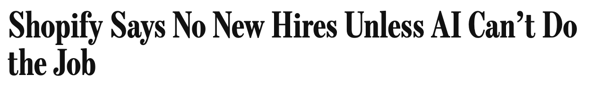
  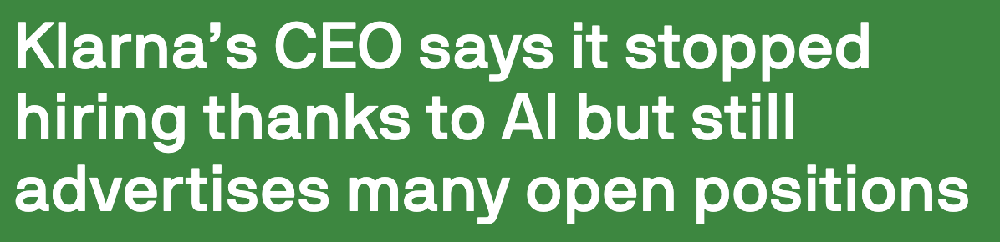
  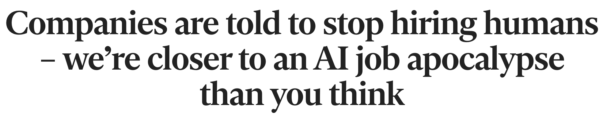
  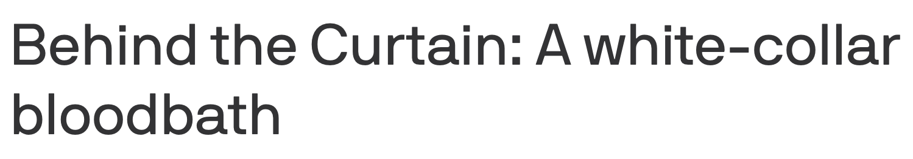
  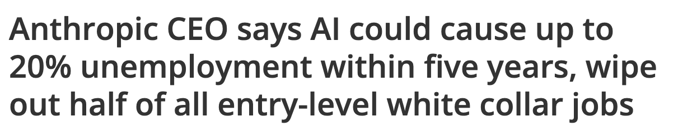
  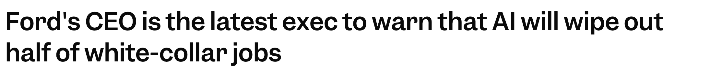
  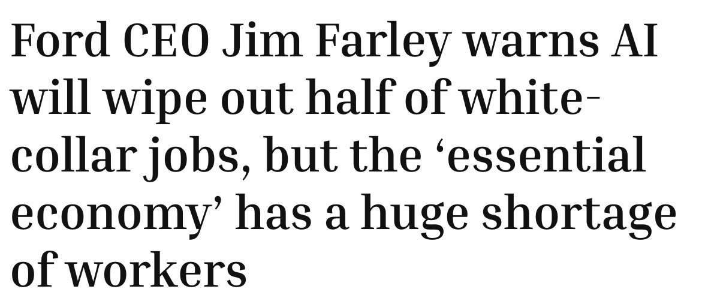
  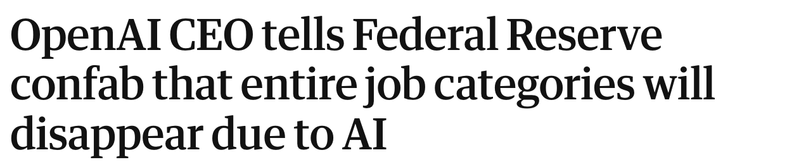
  
  
  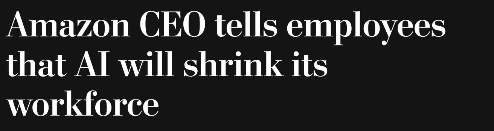
  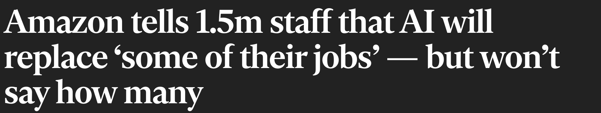
  
  
  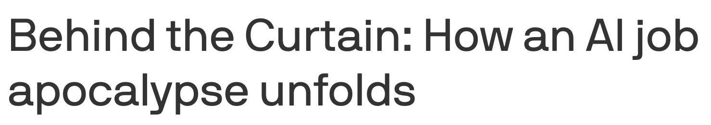
  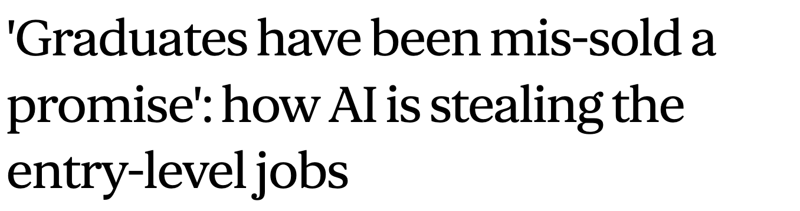
  

<!--
[Sources]
- User-provided article URLs, captured as title-only images in assets/headlines/ on 2026-08-28.
[/Sources]
-->

---
layout: center
class: image-slide
---

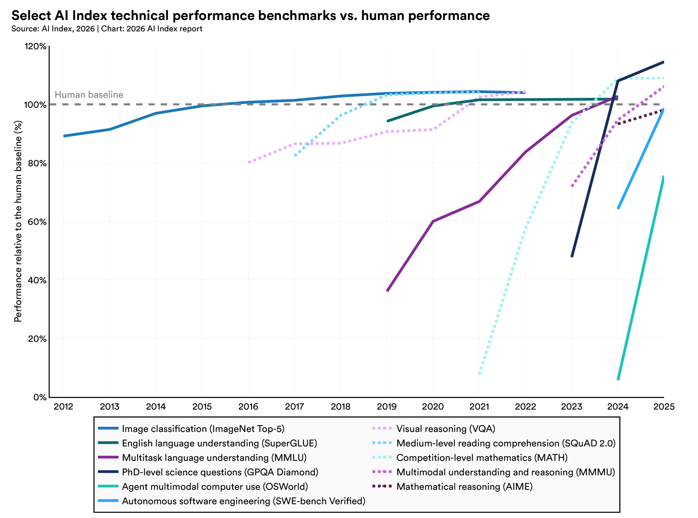

<!--
[Sources]
- Stanford HAI, 2026 AI Index Report, Technical Performance, figure 2.1.1, “Select AI Index technical performance benchmarks vs. human performance”: https://hai.stanford.edu/ai-index/2026-ai-index-report/technical-performance
- Original 2024 × 1505 JPEG, downloaded unmodified on 2026-10-20: https://hai.stanford.edu/assets/images/fig_211.jpg
- © Stanford University. No chart-specific open reuse licence identified; user-requested reproduction from the publisher. General site terms: https://www.stanford.edu/terms
[/Sources]
-->

---
layout: center
class: image-slide chart-zoom-slide
---

<!--
[Sources]
- Zoomed view of the same unmodified Stanford HAI 2026 AI Index chart on the preceding slide, figure 2.1.1: https://hai.stanford.edu/ai-index/2026-ai-index-report/technical-performance
- Original 2024 × 1505 JPEG: https://hai.stanford.edu/assets/images/fig_211.jpg
- © Stanford University. No chart-specific open reuse licence identified; user-requested reproduction from the publisher. General site terms: https://www.stanford.edu/terms
[/Sources]
-->

---
layout: center
class: image-slide chart-zoom-slide chart-zoom-right
---

<!--
[Sources]
- Zoomed view of the same unmodified Stanford HAI 2026 AI Index chart, figure 2.1.1: https://hai.stanford.edu/ai-index/2026-ai-index-report/technical-performance
- Original 2024 × 1505 JPEG: https://hai.stanford.edu/assets/images/fig_211.jpg
- © Stanford University. No chart-specific open reuse licence identified; user-requested reproduction from the publisher. General site terms: https://www.stanford.edu/terms
[/Sources]
-->

---
layout: center
class: image-slide
---

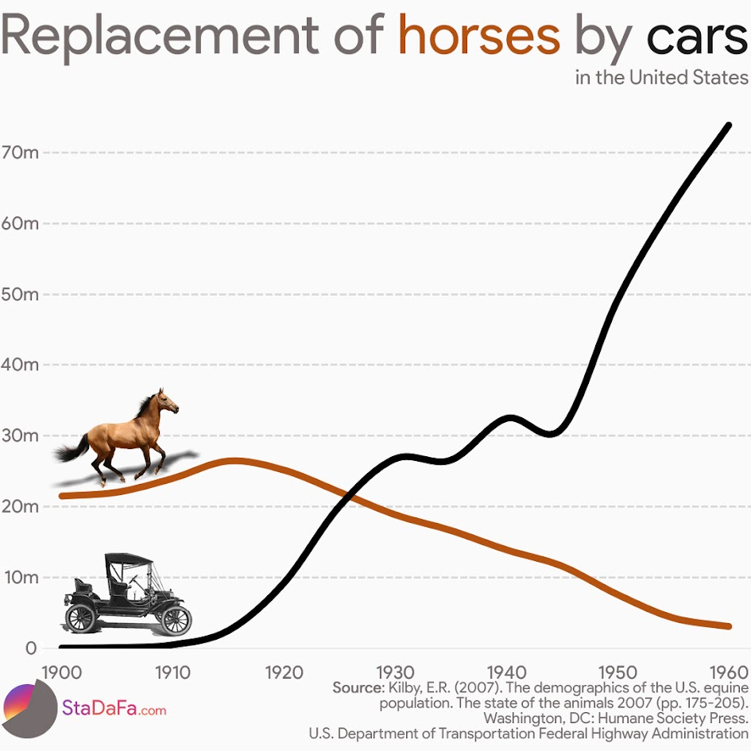

<!--
[Sources]
- StaDaFa.com chart; underlying data sources are credited within the image.
[/Sources]
-->

---
layout: center
class: statement-slide
---

# You are not a horse.

---
layout: center
class: conversion-slide
---

  

    
🥕

    
Food

  

  
→

  

    
🐎

    
Horse

  

  
→

  

    
💪

    
Mechanical work

  

---
layout: center
class: ai-claim-slide
transition: none
---

# AI won’t take your job. Someone using AI will.

---
layout: center
class: ai-claim-slide ai-claim-stamped-slide
---

  <h1>AI won’t take your job. Someone using AI will.</h1>
  
Bullshit

---
layout: center
class: profession-triptych
transition: none
---

  
  
  

<!--
[Sources]
- RDNE Stock project on Pexels: https://www.pexels.com/photo/a-man-sitting-at-the-table-7821715/
- Christina Morillo on Pexels: https://www.pexels.com/photo/photo-of-woman-pointing-on-white-paper-1181487/
- ThisIsEngineering on Pexels: https://www.pexels.com/photo/woman-coding-on-computer-3861958/
[/Sources]
-->

---
layout: center
class: profession-triptych
---

  
  
  

<!--
[Sources]
- Derived from the preceding Pexels photographs with robot-face overlays generated using OpenAI image generation.
[/Sources]
-->

---
layout: center
class: ai-claim-slide
---

# 12 Simple Steps to Guarantee Your Career Survives AI

---
layout: center
class: ai-claim-slide
---

# Nobody knows the future.

---
layout: center
class: timeline-slide
---

<!--
[Sources]
- Original illustration generated for this presentation with OpenAI image generation.
[/Sources]
-->

---
layout: center
class: ai-claim-slide draft-detail-slide
---

  <h1>“It's just completely obvious that in five years deep learning is going to do better than radiologists.”</h1>
  
Geoffrey Hinton — 2016 AI pioneer and Nobel laureate (2024)

<!--
[Sources]
- User-supplied quotation, verified against Creative Destruction Lab, “Geoff Hinton: On Radiology,” published 2016-11-24: https://www.youtube.com/watch?v=2HMPRXstSvQ
- Nobel Prize, 2024 Physics announcement. Nobel laureate is his current credential; the quotation dates from 2016: https://www.nobelprize.org/prizes/physics/2024/press-release/
[/Sources]
-->

---
layout: center
class: ai-claim-slide radiology-quote-slide
---

  <h1>“I think that if you work as a radiologist you are like Wile E. Coyote in the cartoon. You’re already over the edge of the cliff, but you haven’t yet looked down. There’s no ground underneath”</h1>
  
Geoffrey Hinton — 2016

<!--
[Sources]
- User-provided wording of Geoffrey Hinton’s radiology comparison, retained as supplied rather than claimed as a verified verbatim transcript.
- Original recording: Creative Destruction Lab, “Geoff Hinton: On Radiology,” published 2016-11-24: https://www.youtube.com/watch?v=2HMPRXstSvQ
[/Sources]
-->

---
layout: center
class: image-slide
---

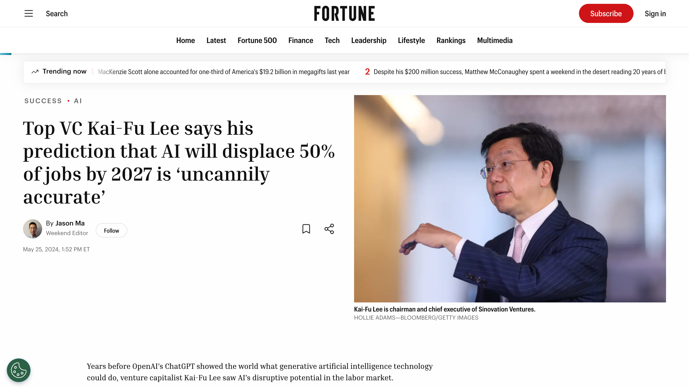

<!--
[Sources]
- Fortune, Jason Ma, 2024-05-25: https://fortune.com/2024/05/25/ai-job-displacement-forecast-50-percent-2027-kai-fu-lee-chatgpt-openai/
- Website screenshot captured from the publisher's rendered page on 2026-10-15 at 2× pixel density, including masthead, navigation, headline, byline, date and article photograph. Copyright Fortune Media IP Limited; photograph credited on the page to Hollie Adams, Bloomberg/Getty Images. All rights reserved; user-requested screenshot, no open reuse licence identified.
[/Sources]
-->

---
layout: center
class: ai-claim-slide draft-detail-slide
---

  <h1>“We might be 6 to 12 months away from when the model is doing most, maybe all of what SWEs do end to end.”</h1>
  
— Dario Amodei, CEO of Anthropic

  
January 2026

<!--
[Sources]
- Dario Amodei, “The Day After AGI,” World Economic Forum Annual Meeting, Davos, 2026-01-20. Official session recording: https://www.youtube.com/watch?v=NnVW9epLlTM
- Official WEF transcript: https://www.weforum.org/podcasts/radio-davos/episodes/ai-agi-dario-amodei-demis-hassabis/ . User-supplied excerpt starts after “I think, I don't know”; SWEs means software engineers.
- Official session listing: https://cn.weforum.org/meetings/world-economic-forum-annual-meeting-2026/sessions/the-day-after-agi/
[/Sources]
-->

---
class: ux-postings-slide historical-headlines-slide
---

  
<strong>1960</strong>“Machines will be capable, within twenty years, of doing any work that a man can do.” <cite>— Herbert Simon</cite>

  
<strong>2011</strong>“Foxconn Will Replace Workers With 1 Million Robots in 3 Years” <cite>— Nicholas Jackson</cite>

  
<strong>2016</strong>“In the production process itself, there essentially would be no people.” <cite>— Elon Musk</cite>

  
<strong>2017</strong>“Facebook engineers panic, pull plug on AI after bots develop their own language” <cite>— Mike Wehner</cite>

  
<strong>2019</strong>“OpenAI built a text generator so good, it’s considered too dangerous to release” <cite>— Zack Whittaker</cite>

<!--
[Sources]
- TechCrunch, Zack Whittaker, 2019-02-17. Headline quoted as published: https://techcrunch.com/2019/02/17/openai-text-generator-dangerous/
- Fox News / BGR, Mike Wehner, 2017-07-31. Historical headline quoted as published, not an endorsement of its claim that Facebook panicked: https://www.foxnews.com/tech/facebook-engineers-panic-pull-plug-on-ai-after-bots-develop-their-own-language
- Elon Musk, Tesla Q2 2016 earnings call, 2016-08-03. Transcript mirror: https://stockanalysis.com/stocks/tsla/transcripts/23973-q2-2016/ . Quotation concerns a future version of production; Musk immediately clarified that people would still maintain and upgrade machines and handle anomalies.
- The Atlantic, Nicholas Jackson, 2011-07-31. Headline quoted as published: https://www.theatlantic.com/technology/archive/2011/07/foxconn-will-replace-workers-with-1-million-robots-in-3-years/242810/
- Herbert A. Simon, The New Science of Management Decision (1960), p. 38. User-supplied quotation excerpt; original sentence begins “Technologically, as I have argued earlier”. Page-level citation and publication history: https://quoteinvestigator.com/2020/11/11/ai-can-do/
- Foxconn follow-up for speaker notes only: BusinessDay, 2015-05-05, reported about 50,000 robots, against the earlier target of one million by 2014: https://www.businessday.co.za/bd/life/gadgets-and-gear/2015-05-05-foxconns-robot-army-yet-to-prove-match-for-humans/
[/Sources]

Foxconn's target was one million robots within three years. By May 2015, a report put its automated workforce at about 50,000 robots. This was a 2015 estimate, not a count at the original 2014 deadline.
-->

---
layout: center
class: ai-claim-slide
---

# Nobody knows the future.

---
layout: center
class: factory-video-slide
---

<SlidevVideo autoplay autoreset="slide" muted playsinline>
  <source src="./assets/factory/steam-factory.mp4" type="video/mp4" />
</SlidevVideo>

<!--
[Sources]
- User-provided video: assets/factory/steam-factory.mp4
[/Sources]
-->

---
layout: center
class: edison-slide
---

<!--
[Sources]
- U.S. National Park Service, “Thomas Edison holding bulb or test tube” (1905), public domain: https://npgallery.nps.gov/AssetDetail/49d152238b9944e280370f2672d02257
[/Sources]
-->

---
layout: center
class: electrified-factory-slide
---

  
  
⚡

<!--
[Sources]
- Opening frame extracted from the user-provided video: assets/factory/steam-factory.mp4
[/Sources]
-->

---
layout: center
class: factory-photo-slide
---

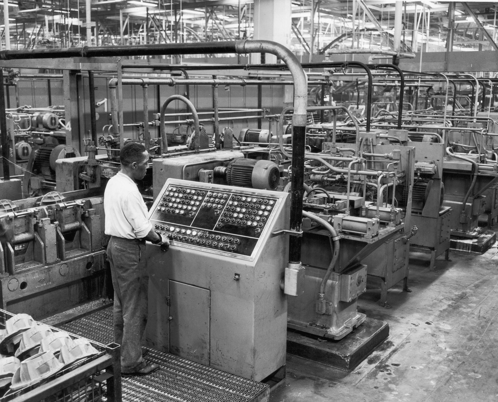

<!--
[Sources]
- User-provided image: assets/factory/factory-control-panel-user-provided.png
[/Sources]
-->

---
layout: center
class: "durant-diptych red-flag-full-photos"
---

  

    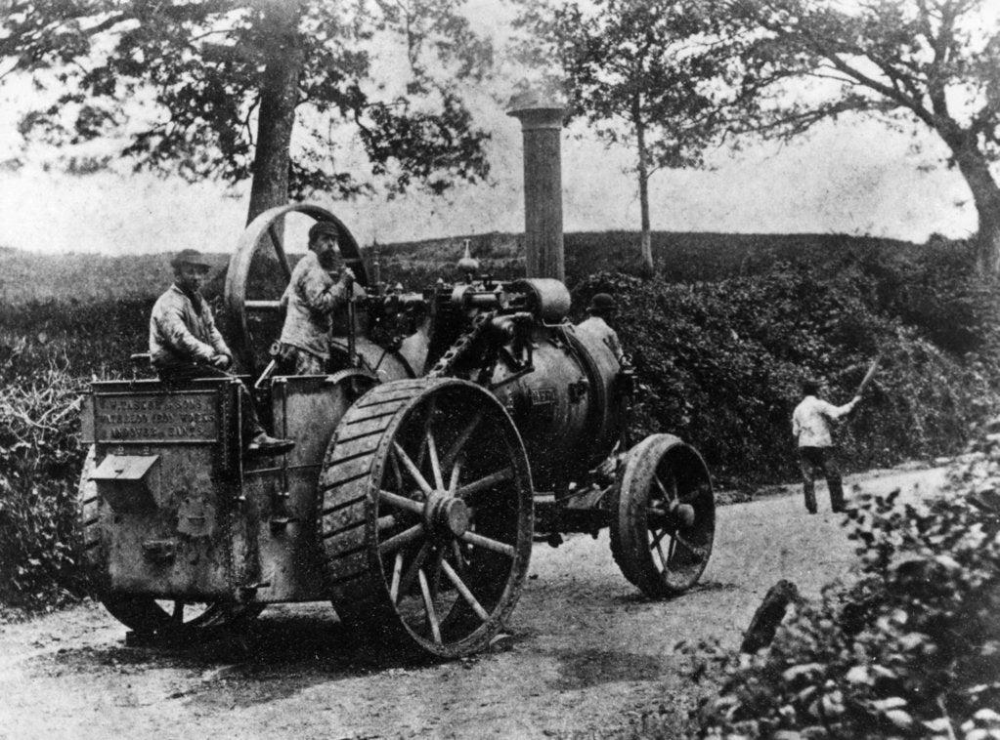
  

  

    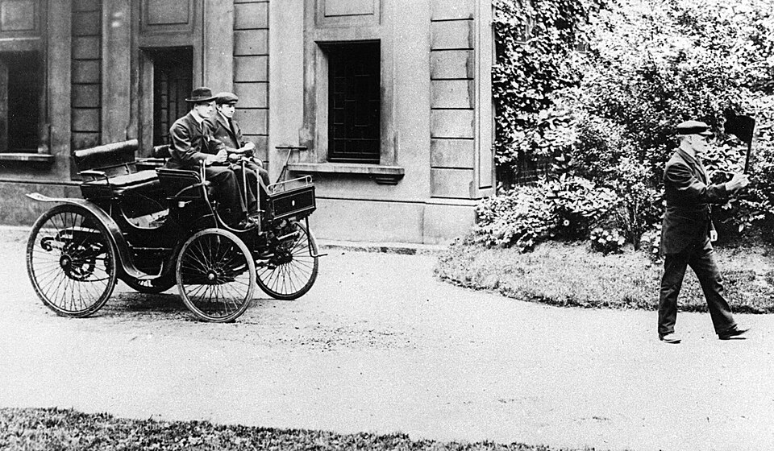
  

  
A man walking in front of a machine holding a red flag.

<!--
[Sources]
- User-provided image: assets/red-flag/red_flag_1.jpg
- User-provided image: assets/red-flag/red_flag_2.jpg
[/Sources]
-->

---
layout: center
class: durant-diptych
---

  

    
    

      1886
      <strong>William Durant</strong>
    

  

  

    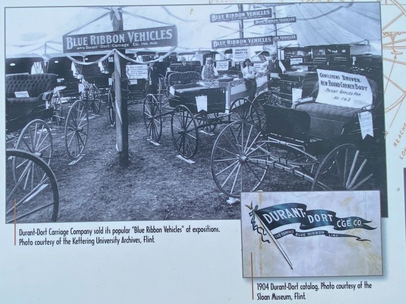
    

      Horse-drawn vehicles
      <strong>Durant-Dort Carriage Company</strong>
    

  

<!--
[Sources]
- User-provided image: assets/durant/durant_portrait.png
- User-provided image: assets/durant/durant_carriage_company.png
- General Motors, “Story of GM Founder, William Durant”: https://www.gm.com/heritage
[/Sources]
-->

---
layout: center
class: durant-diptych
---

  

    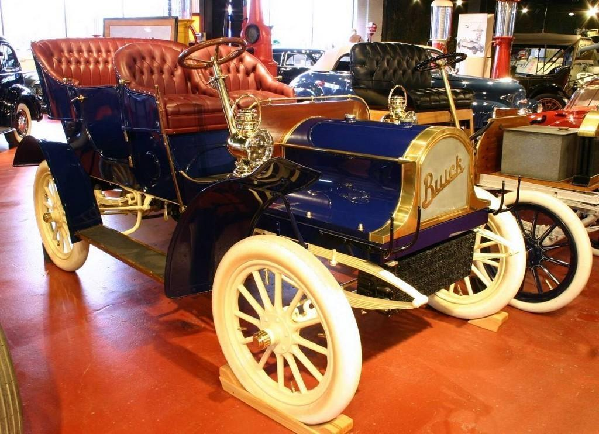
    

      1904
      <strong>BUICK</strong>
    

  

  

    
    

      1908
      <strong>GENERAL MOTORS</strong>
    

  

<!--
[Sources]
- User-provided image: assets/durant/buick.jpg
- User-provided image: assets/durant/gm.png
- General Motors, “Story of GM Founder, William Durant”: https://www.gm.com/heritage
[/Sources]
-->

---
layout: center
class: durant-diptych
---

  

    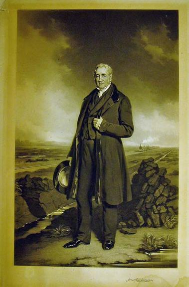
    

      1781–1848
      <strong>George Stephenson</strong>
    

  

  

    
    

      1825
      <strong>Locomotion No. 1</strong>
    

  

<!--
[Sources]
- John Lucas (artist) and Thomas Lewis Atkinson (engraver), “Portrait of George Stephenson standing on Chat Moss” (1849), Science Museum Group Collection, object 1978-2021. CC BY-NC-SA 4.0: https://collection.sciencemuseumgroup.org.uk/objects/co420171/engraving-portrait-of-george-stephenson-standing-on-chat-moss-by-john-lucas-1849
- Historic England Archive, “The S&DR's Locomotion No.1 displayed as a historical artifact at Darlington railway station in the early 20th century,” image reference BB057004. © Historic England Archive; reproduction permission required: https://historicengland.org.uk/whats-new/research/a-brief-overview-of-the-stockton-and-darlington-railway/
- Historic England Archive image-use policy: https://historicengland.org.uk/images-books/archive/policies/using-images/
[/Sources]
-->

---
layout: center
class: ai-claim-slide raspberry-question-slide
---

  
  <h1>How many R’s are in raspberry?</h1>

<!--
[Sources]
- User-provided question: “How many R’s are in raspberry?”
- Raspberry icon generated with OpenAI's built-in image-generation tool on 2026-10-27; transparent PNG, no third-party source asset.
- Generation prompt: Create a single raspberry icon in a polished emoji style for a presentation slide. One ripe red raspberry with a recognizable tapered cluster of rounded drupelets and a small green calyx at the top. Friendly dimensional shading, clean silhouette, centered in a square canvas with a little clear margin. A raspberry, not a strawberry. Transparent background. No text, letters, numbers, border, badge, plate, extra fruit, or watermark.
[/Sources]
-->

---
layout: center
class: ux-postings-slide ai-learning-slide
---

<h1>Know the machine</h1>

  <section aria-labelledby="learning-vocabulary">
    <h2 id="learning-vocabulary">Vocabulary</h2>
    <ul>
      <li>Token / tokenizer</li>
      <li>Transformer</li>
      <li>Embedding</li>
      <li>Context window</li>
      <li>Dense vs Mixture of Experts</li>
      <li>Multimodal model</li>
      <li>Prompt vs system prompt</li>
      <li>Temperature / top-p sampling</li>
      <li>Structured output</li>
      <li>Tool / function calling / MCP</li>
      <li>TTFT / tokens per second / KV cache / prompt caching</li>
      <li>RAG vs fine-tuning</li>
      <li>Quantisation vs distillation</li>
    </ul>
  </section>
  <section aria-labelledby="learning-questions">
    <h2 id="learning-questions">Questions</h2>
    <ul>
      <li>Why hallucinate, even with web access?</li>
      <li>Why is counting letters in “raspberry” hard?</li>
      <li>Why can the same prompt give different answers?</li>
      <li>How does a language model understand images?</li>
    </ul>
  </section>
  <section aria-labelledby="learning-experiments">
    <h2 id="learning-experiments">Experiments</h2>
    <ul>
      <li>Run an LLM on your computer</li>
      <li>Run an LLM on your phone</li>
      <li>Run a local vision-language model; describe or analyse an image</li>
      <li>Compare one task across 3 model sizes</li>
      <li>Compare one model’s quantisation levels: memory, speed &amp; answer quality</li>
      <li>Vary temperature, context length &amp; inference settings</li>
      <li>Fine-tune with LoRA</li>
      <li>Distil a large model into a smaller one</li>
      <li>Embed your own documents</li>
      <li>Generate images with ComfyUI</li>
      <li>Run speech-to-text locally</li>
    </ul>
  </section>

<!--
[Sources]
- User-provided vocabulary, questions and starter checklist, shortened for this slide; all 13 vocabulary groups, 4 questions and 11 experiments retained.
[/Sources]
-->

---
layout: center
class: ai-claim-slide draft-detail-slide bad-ai-slide
---

  <h1>How to use AI badly.</h1>
  <ol class="bad-ai-list">
    <li>Do the same work faster.</li>
    <li>Make your job easier.</li>
    <li>Produce more unchecked output.</li>
    <li>Avoid learning.</li>
  </ol>

<!--
[Sources]
- Author's four criticisms from draft.md, “Using AI for the wrong things,” summarised for this slide.
[/Sources]

Are you doing your work faster? Everyone is doing it. It's just a requirement at that point, like knowing how to use Figma.
Is it making your job easier? You're reducing your own market value. Now someone cheaper can do it.
You're producing more work. Who is reviewing it? You're creating more work without delivering more value.
And lastly, my favourite one. People who use AI to avoid learning. You get results without understanding how they work. There is absolutely zero value in hiring you because anyone can do that.
-->

---
layout: center
class: "statement-slide meat-proxy-slide"
---

  <h1>Meat proxy</h1>
  
a human who relays work to and from an AI without adding meaningful <strong>judgment</strong> or <strong>value</strong>.

---
layout: center
class: ai-claim-slide
---

# Why were you hired in the first place?

<!--
[Sources]
- Author's question from draft.md, “Why were you hired in the first place?”
[/Sources]

Before we talk about AI replacing your job, let's start with a simple question.
Why is your company paying you so much money?
-->

---
class: ux-postings-slide
---

<h1>UX Designer postings</h1>

1,500 jobs reviewed

  
Collaboration &amp; communication<strong>90%</strong>

  
Design craft &amp; methods<strong>85%</strong>

  
Named design tools<strong>63%</strong>

  
Credentials (portfolio, degree)<strong>60%</strong>

  
User research &amp; validation<strong>46%</strong>

  
AI fluency<strong>32%</strong>

  
Coding adjacency<strong>14%</strong>

<!--
[Sources]
- User-provided category labels, percentages and sample size: 1,500 UX Designer postings reviewed.
[/Sources]
-->

---
layout: center
class: ai-claim-slide
---

# The cost of getting it wrong.

<!--
[Sources]
- Illustrative software-team scenario from draft.md, “The cost of getting is wrong.” This is a hypothetical progression, not measured delivery-time data.
[/Sources]

Let's take an average team building a software product.
At first, everything moves quickly. Feature gets built and shipped on time. Everyone's happy.
But nobody checks how the changes affect the rest of the product and bad decisions keep pilling on. For a while, it doesn't matter because the team keeps meeting its deadlines.
Then things start breaking. Fixes are getting increasingly complicated.
Customers complain. The next release gets postponed. The team spends another week fixing the previous release.
After a while, features that used to take days take weeks, then months and eventually nothing gets shipped. Everyone is scared to touch anything because they don't know what will break.
The company is paying an entire team to deal with the consequences of its previous bad decisions instead of shipping software to customers.
-->

---
layout: center
class: ai-claim-slide decision-thesis-slide
---

  <h1>You are paid tomake good decisions.</h1>
  <ul class="decision-conditions">
    <li>With incomplete information.</li>
    <li>Under constraints.</li>
    <li>Without constant supervision.</li>
  </ul>

<!--
[Sources]
- Author's central argument from draft.md, “You are paid to make good decisions.”
[/Sources]

There used to be a physical limit to how many bad decisions someone could make. This is no longer the case with AI.
It doesn't matter if AI can "do your job". More than even, there is one reason why you are getting paid.
You are paid to consistently make good decisions with incomplete information, under constraints and without constant supervision.
That includes knowing how to ship useful work on time without turning the product into something that breaks whenever someone changes it.
-->

---
layout: center
class: ai-claim-slide
---

# Attention is all you have.

<!--
[Sources]
- Author's framing from draft.md, “Attention is all you need.”
[/Sources]

If you're paid to think and make good decisions, your ability to process information and make decisions is limited. You only have so much attention and mental energy each day.
-->

---
layout: center
class: ai-claim-slide draft-detail-slide attention-options-slide
---

  <h1>Three options.</h1>
  <ol class="attention-options">
    <li>1<strong>Reduce the quality.</strong></li>
    <li>2<strong>Delegate the decisions.</strong></li>
    <li>3<strong>Automate the process.</strong></li>
  </ol>

<!--
[Sources]
- Author's three-option framing from draft.md, “Attention is all you need.”
[/Sources]

If you want to achieve more, you have a few options:
1. Reduce the quality. Make decisions faster, spend less time thinking about the consequences and accept more mistakes.
2. Delegate decisions to AI. But making good decisions is what you're paid for. If AI can do that without your judgment, why does your employer need you?
3. Automate the entire process.
-->

---
layout: center
class: factory-photo-slide draft-caption-slide
---

<h1 class="draft-image-caption">We haven’t redesigned the factory yet.</h1>

<!--
[Sources]
- Author's factory callback from draft.md, “We haven't redesigned the factory yet.”
- Still extracted from the user-provided video: assets/factory/steam-factory.mp4. Used as a metaphor for the existing process.
[/Sources]

Someone investigates a customer problem and writes a ticket. A designer proposes a solution. An engineer implements it. Someone reviews the change, someone tests it and eventually it reaches customers.
Give everyone an AI tool and each person can complete their part faster.
We've been given the power to automate so much more. Somehow we're using it to do exactly the same work a little faster.
Why are we keeping the same process?
-->

---
layout: center
class: ai-claim-slide
---

# Never correct the AI

<!--
[Sources]
- User-provided slide wording: “Never correct the AI”.
[/Sources]
-->

---
layout: center
class: ai-claim-slide draft-detail-slide
---

  <h1>Automate the entire process.</h1>
  

    

Decide

    
→

    

Execute

    
→

    

Verify

  

  
Without constant supervision.

<!--
[Sources]
- Author's proposed approach from draft.md, “Attention is all you need.” This is the desired system behaviour, not a claim that every process can currently be automated.
[/Sources]

Build systems that can make decisions, execute them and verify the results without constant supervision. Then use the capacity you've gained to solve more problems.
Number 3 is the only correct answer. It is time to tackle the problems we never had the time, money or resources to solve.
-->

---
layout: center
class: ai-claim-slide
---

# Replace yourself. Automate everything.

<!--
[Sources]
- User-provided closing message: “Replace yourself. Automate everything.”
[/Sources]
-->

---
layout: center
class: ai-claim-slide
---

<a class="blog-link" href="https://blog.florianherrengt.com/" target="_blank" rel="noopener noreferrer">
  
  blog.florianherrengt.com
</a>

<!--
[Sources]
- User-provided blog URL: https://blog.florianherrengt.com/
- QR code generated locally with macOS Core Image, encoding the same URL; no external artwork.
[/Sources]
-->
